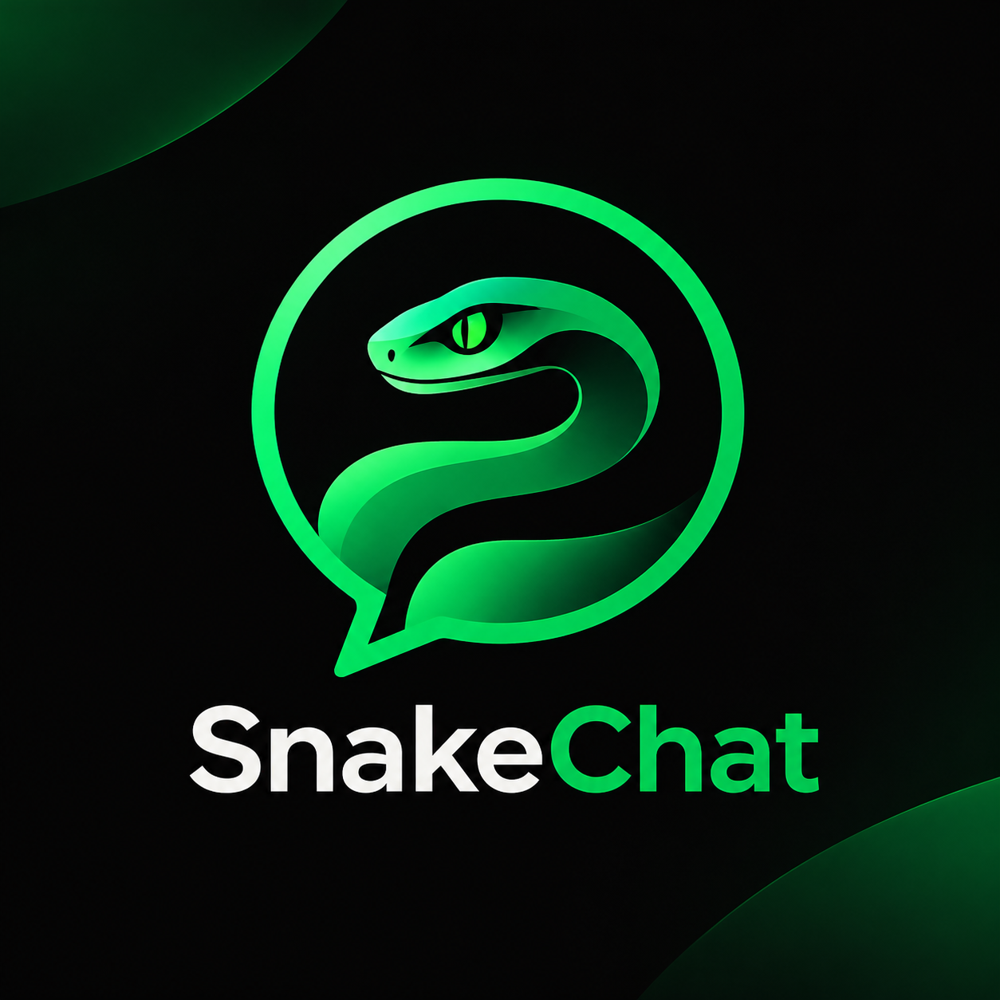

# <p align="center">(En Desarrollo) SnakeChat WA 🐍</p> <p align="center"> 
</p>

[](https://wa.me/50557418454)
[](mailto:allstarf123@gmail.com)
[](https://github.com/ToxiPain/Snakechat/releases)
[](https://github.com/ToxiPain/Snakechat)
[](https://github.com/ToxiPain/Snakechat/commits/main)

SnakeChat es un proyecto de API WebSocket basado en una conexión no oficial de WhatsApp Web, diseñado principalmente para ser utilizado en Python. No requiere tokens ni claves externas para funcionar. Soporta interacciones con WhatsApp Web y es totalmente compatible con WhatsApp Multi-Devices. Al mismo tiempo, se busca que la conexión proporcione la mayoría de las funciones operativas básicas para evitar el uso de varias bibliotecas y dependencias adicionales en tu proyecto.

### Información:
* **SnakeChat no requiere el uso de Selenium u otros navegadores que afecten la velocidad de respuesta, ya que basa su funcionamiento directamente en websockets, lo que genera una interfaz de usuario funcional basado en lenguaje Python. Esto también implica que el proyecto en cuestión que utilice SnakeChat no utilizará más de 1GB de RAM en recursos para su funcionamiento estandar, támbien permitiendo el uso de JID a diferencia de alternativas como Playwright/Puppeteer sino con los métodos mencionados anteriormente.**
- - -
### Funciones:
| Compatibilidad con | Status | Ejemplo |
|---|:---:|---|
| Multidevice | ✅ | Vinculación MD |
| Chat privado y grupos | ✅ | Funciones disponibles |
| Leer mensajes | ✅ | Función de visto |
| Envío de mensajes de texto | ✅ | Text Message |
| Envío de mensajes de respuesta | ✅ | Reply Message |
| Información de usuario | ✅ | Name, LID, Status, etc. |
| Reacciones de mensajes | ✅ | Con todos los emoji |
| Estado: Escribiendo | ✅ | Simular escritura |
| Mencionar usuarios | ⏭️ | Próximamente... |
| Mencionar grupos | ⏭️ | Próximamente... |
| Enviar media (imagen/audio/documentos) | ⏭️ | Próximamente... |
| Enviar stickers (imagen/GIF) | ⏭️ | Próximamente... |
| Enviar video | ⏭️ | Próximamente... |
| Leer información de grupo | ⏭️ | Próximamente... |
| Leer eventos en tiempo real de grupo | ⏭️ | Próximamente... |
| Modificar grupos/participantes | ⏭️ | Próximamente... |
| Crear encuestas | ⏭️ | Próximamente... |
| Enviar botones | ⏭️ | Próximamente... |
| Enviar listas | ⏭️ | Próximamente... |
| Enviar contactos | ⏭️ | Próximamente... |
- - -
### Instalación:
**Instalación directa:**
```bash
py -m pip install "git+https://github.com/ToxiPain/Snakechat.git"
```
**Instalación vía archivo `requirements.txt`:**
```txt
snakechat @ git+https://github.com/ToxiPain/Snakechat.git
```
- - -
### Ejemplo de uso:
**Crear la instancia de `SnakeChatClient` e inicializar:**
```python
import asyncio
from client import SnakeChatClient

client = SnakeChatClient(debug=False)

# Escuchar cuando la conexión esté lista:
@client.on("ready")
async def on_ready(jid: str):
    print(f"[+] Conectado como: {jid}")

# Ejecutar el bot (punto de entrada)
if __name__ == "__main__":
    asyncio.run(client.start())
```
**Escuchar mensajes entrantes:**
```python
from wapipeline.connection import IncomingMessage

@client.on("message")
async def on_message(umsg: IncomingMessage):
    if not umsg.text:
        return

    chat_jid = umsg.chat_jid
```
**Envio de mensajes:**
```python
await client.send_msg(chat_jid, "¡Hola Mundo!")
```
**Envio de respuesta de mensajes:**
```python
await client.reply_msg(chat_jid, "¡Hola Mundo!", quoted=umsg)
```
**Lectura de mensajess:**
```python
await client.read_msg(umsg)
```
**Reacción de mensajes:**
```python
await client.react_msg(chat_jid, "👍", target=umsg)
```
- - -
### Disclaimer:
Este proyecto no es oficial de Whatsapp ni está afiliado ni respaldado por Meta. Todas las marcas y logotipos pertenecen a sus respectivos propietarios ([whatsapp.com](https://www.whatsapp.com/)).
SnakeChat utiliza métodos no oficiales de conexión a WhatsApp Web, cuyo uso puede provocar restricciones o bloqueos de cuenta. El uso de esta herramienta es bajo tu propia responsabilidad. Los desarrolladores no se hacen responsables de las consecuencias derivadas de su uso.
- - -
### Runea el ejemplo:
**Ver script de ejemplo:** [Example](https://github.com/ToxiPain/Snakechat/blob/main/example/example.py)
- - -
[](https://ko-fi.com/toxipain)

